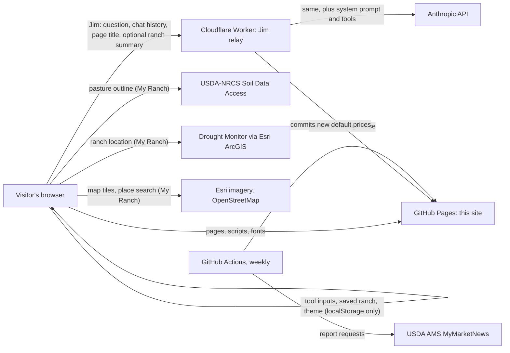

# Operations: ownership, data flows and support

Last updated: 2026-10-16. Companion to `SECURITY.md` (controls) and `src/README.md` (how to build and test).

## Ownership

| Role | Who | Responsible for |
| --- | --- | --- |
| Program owner | Dr. Francisco (Pancho) Abello, Agricultural Economics, Texas A&M AgriLife Extension | Content and numbers on the site, approval of changes, the D03 budgets |
| Developer / maintainer | Juan Bautista Bruno, Graduate Assistant Researcher, Agricultural Economics (through Dec 2027) | Code, tests, deployments, the Jim relay, the weekly price job |
| Hosting, review, long-term support | To be agreed with AgriLife CMTS | Platform, domain, HTTP headers, accessibility audit, maintenance after Dec 2027 |

## Components and accounts

| Component | Where it runs | Account (today) | Target |
| --- | --- | --- | --- |
| Website (static HTML/CSS/JS) | GitHub Pages | GitHub `JuanBruno14/AgExtensionTAMU` (personal) | AgriLife / Ag Econ GitHub organization or CMTS hosting, AgriLife domain |
| Jim relay | Cloudflare Worker `jim` | Personal Cloudflare account | Institutional account |
| Jim AI model | Anthropic API (Claude) | Dedicated key with monthly spend limit | Institutional account, AgriLife-approved provider |
| Weekly USDA prices | GitHub Actions (`update-prices.yml`), secret `AMS_API_KEY` | Same repository | Same, moves with the repository |
| Automated tests | GitHub Actions (`tests.yml`) | Same repository | Same |

Secrets live only in GitHub repository secrets (`AMS_API_KEY`) and Cloudflare Worker secrets (`ANTHROPIC_API_KEY`). None are in the code.

## Data flows

| Data | Stored | Leaves the browser? | Retention |
| --- | --- | --- | --- |
| Prices, costs, herd calculator inputs | Visitor's browser (localStorage) | No | Until the visitor clears it (button on `privacy.html`) |
| My Ranch map, herd, feed plan | Visitor's browser; optional file the visitor downloads | Outline to NRCS soils; location to Drought Monitor and map services | Same |
| Jim conversation | Visitor's browser (sessionStorage) | Yes, to the Worker and Anthropic, per question | Browser: until the tab closes. Worker: none (no storage, no message logging). Anthropic: under its commercial API terms |
| Saved-ranch summary for Jim | Visitor's browser | Only with Jim's "Use my saved ranch" switch on (max 3,500 characters) | Same as the conversation |
| Default market prices | `data/market-prices.json` in the repository | Public | Git history |

No accounts, cookies, analytics, databases or personal-information forms.

## Routine updates

| What | When | How | Who |
| --- | --- | --- | --- |
| USDA AMS prices (bred cow, bred heifer, fed cattle) | Weekly, automatic (Mon) | `update-prices.yml`; moves over 25% or missing classes open an issue instead | Automatic; developer checks issues |
| D03 budgets in Jim | When a new D03 workbook is published (yearly) | Update `BUDGET_SUMMARY` in `worker/jim-worker.js` and redeploy; replace `jim/kb.json` | Developer, numbers approved by program owner |
| Knowledge base `jim/kb.json` | When manuals or site tools change | Edit or regenerate the chunks; the Worker reloads it within 6 hours | Developer |
| Third-party libraries | Every few months or on an advisory | `vendor/README.md` | Developer |
| Security pass | After any page edit | `python3 tools/secure_pages.py` (builds run it automatically) | Developer |

Known gap: the scripts that first generated `jim/kb.json` from the manual PDFs and the D03 workbook are not in this repository. Until they are rebuilt, the knowledge base is edited directly.

## Support expectations

- Best-effort support by the developer during business hours while enrolled (through Dec 2027); no on-call.
- If Jim fails, the rest of the site keeps working; the chat shows an error and producers can still use every tool.
- If a map service is down, My Ranch still saves and calculates; soils or drought lookups show a message.
- Incidents (spend alert, abuse, wrong numbers): turn Jim off by removing the `ANTHROPIC_API_KEY` secret in Cloudflare (Jim then shows "not available") or disabling the key in the Anthropic console; fix; record what happened in the repository.
- Hand-off before Dec 2027: move the repository, Worker and keys to institutional accounts; transfer this document and `SECURITY.md`; walk the new maintainer through the tests.

## Access reviews

Each semester: list who has write access to the GitHub repository, the Cloudflare account and the Anthropic organization; remove anyone who no longer needs it; rotate the Anthropic key if anyone with access has left.
